# Gallery

All 95 looks: 69 dark and 26 light. The name under each one is what you type: `/look <name>` with the bundle, or install the single look `look-<name>`.

Each preview is a rendering built from the look's colors, with its backdrop gradient and frosted panels. They are not captures from the app, which picks some colors itself, so a look may differ slightly on screen.

For search and filters, there is an [interactive version](https://claude.ai/artifact/NmsFaUQA6dtLgeQcQJVxHj). Cloning the repository also gives you `docs/index.html`, the same page, to open in a browser.

[Dark](#dark) · [Light](#light) · [Credits](CREDITS.md) · [Back to the README](README.md)

## Dark (69)

<table>
<tr>
<td align="center" valign="top" width="33%"><a href="gallery/previews/mocha.svg">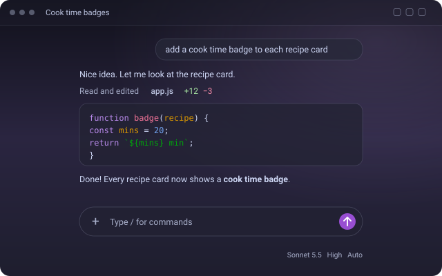</a> <b>Catppuccin Mocha</b> <code>mocha</code></td>
<td align="center" valign="top" width="33%"><a href="gallery/previews/nord.svg">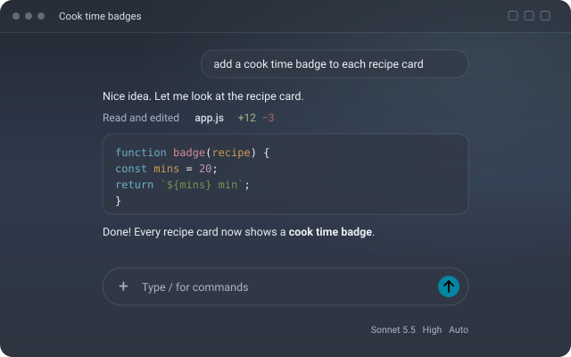</a> <b>Nord</b> <code>nord</code></td>
<td align="center" valign="top" width="33%"><a href="gallery/previews/dracula.svg">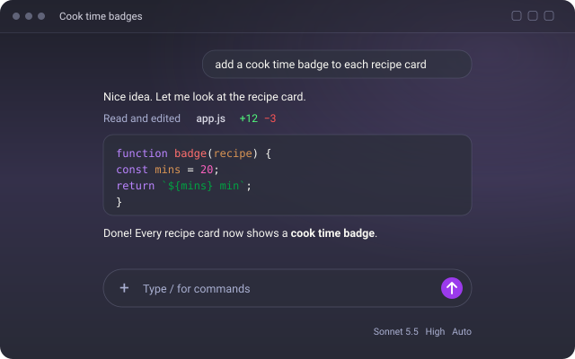</a> <b>Dracula</b> <code>dracula</code></td>
</tr>
<tr>
<td align="center" valign="top" width="33%"><a href="gallery/previews/tokyo-night.svg">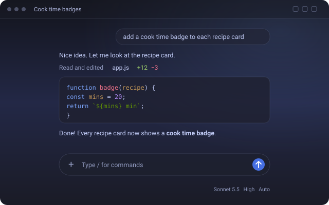</a> <b>Tokyo Night</b> <code>tokyo-night</code></td>
<td align="center" valign="top" width="33%"><a href="gallery/previews/gruvbox.svg">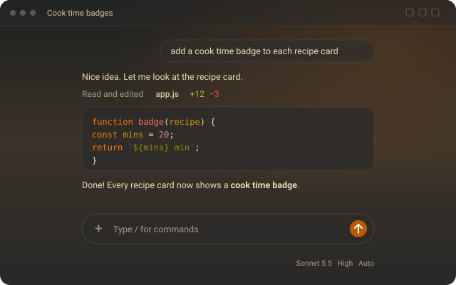</a> <b>Gruvbox Dark</b> <code>gruvbox</code></td>
<td align="center" valign="top" width="33%"><a href="gallery/previews/rose-pine.svg">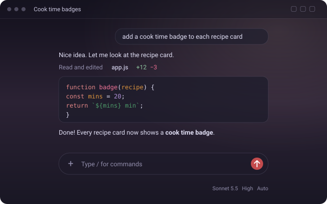</a> <b>Rosé Pine</b> <code>rose-pine</code></td>
</tr>
<tr>
<td align="center" valign="top" width="33%"><a href="gallery/previews/everforest.svg">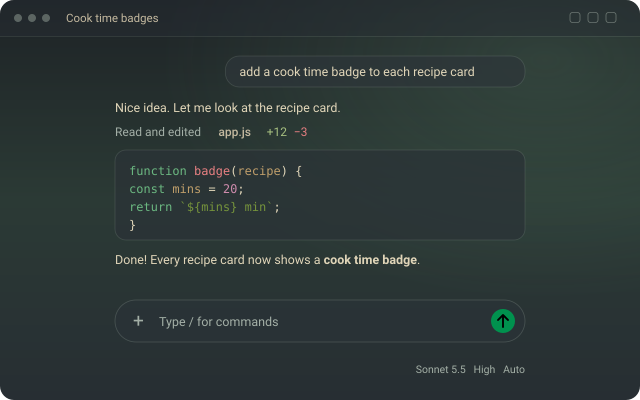</a> <b>Everforest</b> <code>everforest</code></td>
<td align="center" valign="top" width="33%"><a href="gallery/previews/solarized-dark.svg">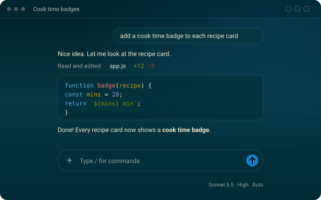</a> <b>Solarized Dark</b> <code>solarized-dark</code></td>
<td align="center" valign="top" width="33%"><a href="gallery/previews/frappe.svg">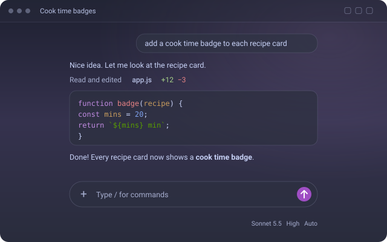</a> <b>Catppuccin Frappé</b> <code>frappe</code></td>
</tr>
<tr>
<td align="center" valign="top" width="33%"><a href="gallery/previews/macchiato.svg">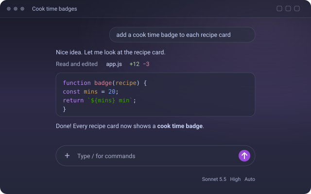</a> <b>Catppuccin Macchiato</b> <code>macchiato</code></td>
<td align="center" valign="top" width="33%"><a href="gallery/previews/one-dark.svg">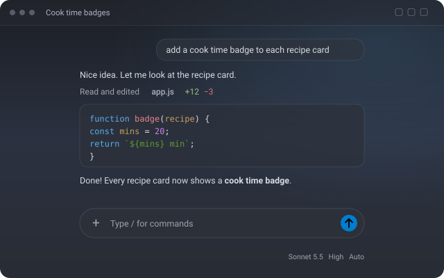</a> <b>One Dark</b> <code>one-dark</code></td>
<td align="center" valign="top" width="33%"><a href="gallery/previews/kanagawa.svg">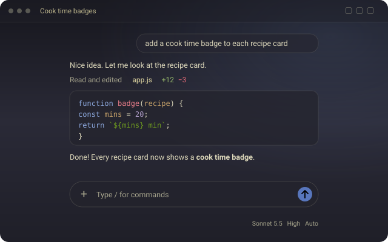</a> <b>Kanagawa</b> <code>kanagawa</code></td>
</tr>
<tr>
<td align="center" valign="top" width="33%"><a href="gallery/previews/ayu-mirage.svg">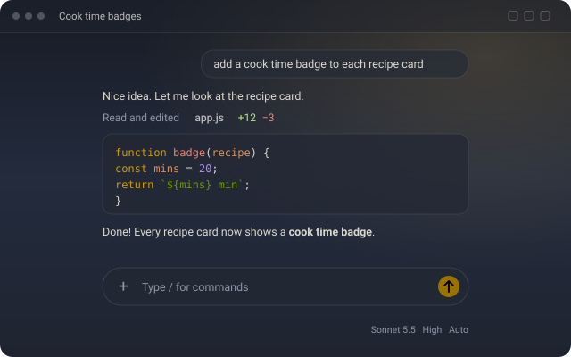</a> <b>Ayu Mirage</b> <code>ayu-mirage</code></td>
<td align="center" valign="top" width="33%"><a href="gallery/previews/github-dark.svg">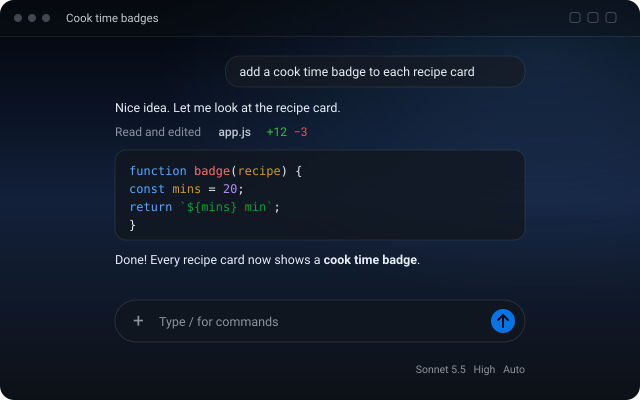</a> <b>GitHub Dark</b> <code>github-dark</code></td>
<td align="center" valign="top" width="33%"><a href="gallery/previews/night-owl.svg">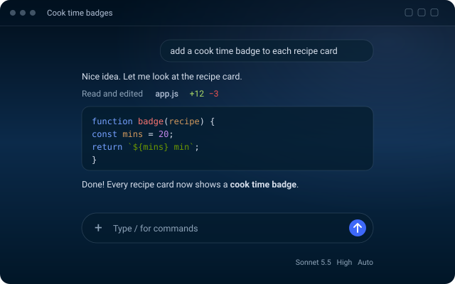</a> <b>Night Owl</b> <code>night-owl</code></td>
</tr>
<tr>
<td align="center" valign="top" width="33%"><a href="gallery/previews/synthwave.svg">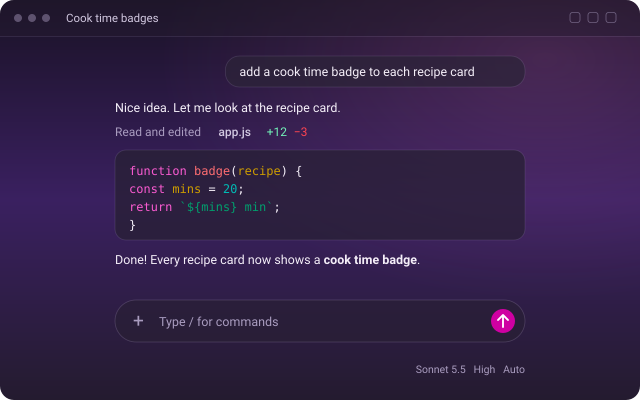</a> <b>Synthwave &#39;84</b> <code>synthwave</code></td>
<td align="center" valign="top" width="33%"><a href="gallery/previews/monokai.svg">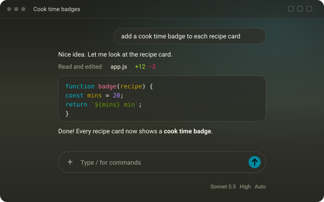</a> <b>Monokai</b> <code>monokai</code></td>
<td align="center" valign="top" width="33%"><a href="gallery/previews/amber-crt.svg">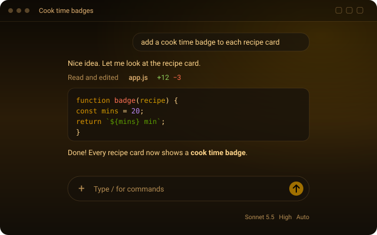</a> <b>Amber CRT</b> <code>amber-crt</code></td>
</tr>
<tr>
<td align="center" valign="top" width="33%"><a href="gallery/previews/tokyo-night-storm.svg">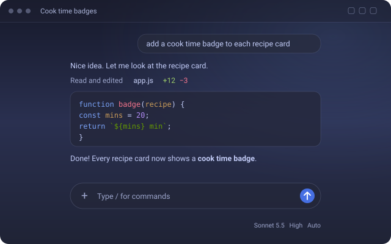</a> <b>Tokyo Night Storm</b> <code>tokyo-night-storm</code></td>
<td align="center" valign="top" width="33%"><a href="gallery/previews/nightfox.svg">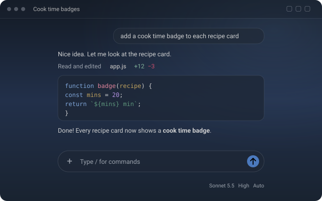</a> <b>Nightfox</b> <code>nightfox</code></td>
<td align="center" valign="top" width="33%"><a href="gallery/previews/oxocarbon.svg">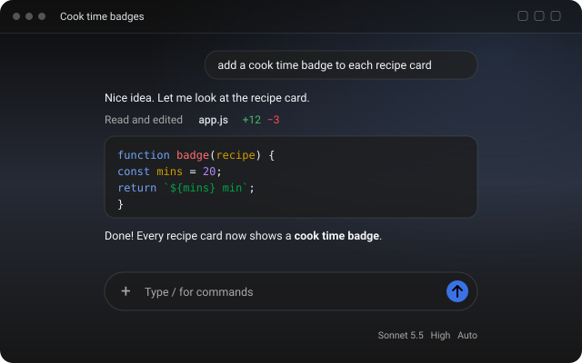</a> <b>Oxocarbon</b> <code>oxocarbon</code></td>
</tr>
<tr>
<td align="center" valign="top" width="33%"><a href="gallery/previews/material-ocean.svg">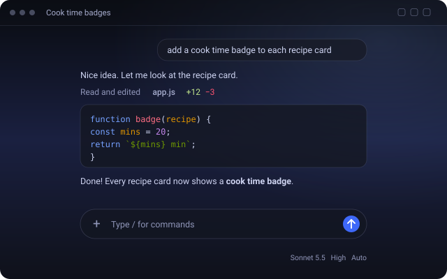</a> <b>Material Ocean</b> <code>material-ocean</code></td>
<td align="center" valign="top" width="33%"><a href="gallery/previews/zenburn.svg">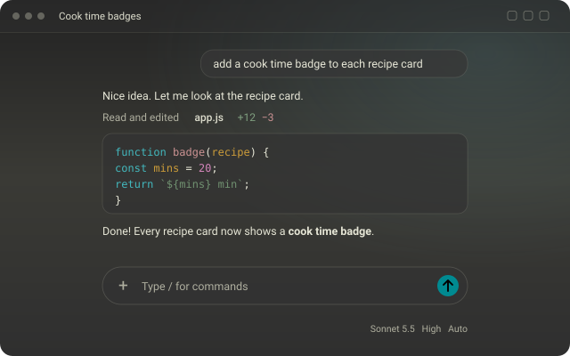</a> <b>Zenburn</b> <code>zenburn</code></td>
<td align="center" valign="top" width="33%"><a href="gallery/previews/deep-sea.svg">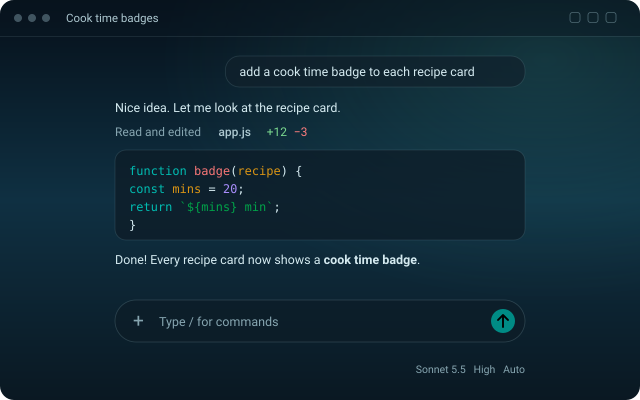</a> <b>Deep Sea</b> <code>deep-sea</code></td>
</tr>
<tr>
<td align="center" valign="top" width="33%"><a href="gallery/previews/mint-chocolate.svg">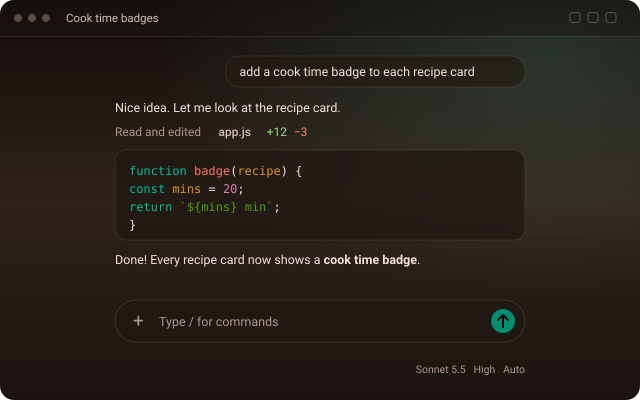</a> <b>Mint Chocolate</b> <code>mint-chocolate</code></td>
<td align="center" valign="top" width="33%"><a href="gallery/previews/winter-is-coming-dark-blue.svg">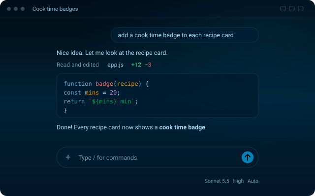</a> <b>Winter is Coming (Dark Blue)</b> <code>winter-is-coming-dark-blue</code></td>
<td align="center" valign="top" width="33%"><a href="gallery/previews/one-monokai.svg">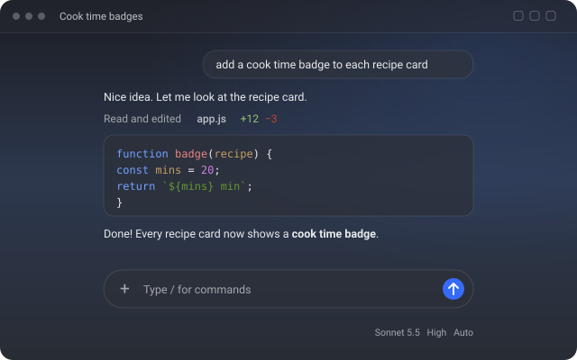</a> <b>One Monokai</b> <code>one-monokai</code></td>
</tr>
<tr>
<td align="center" valign="top" width="33%"><a href="gallery/previews/palenight-theme.svg">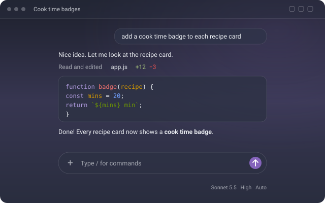</a> <b>Palenight Theme</b> <code>palenight-theme</code></td>
<td align="center" valign="top" width="33%"><a href="gallery/previews/cobalt2.svg">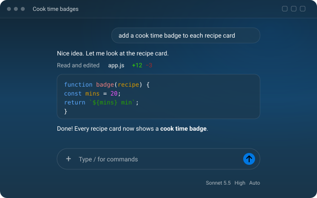</a> <b>Cobalt2</b> <code>cobalt2</code></td>
<td align="center" valign="top" width="33%"><a href="gallery/previews/andromeda.svg">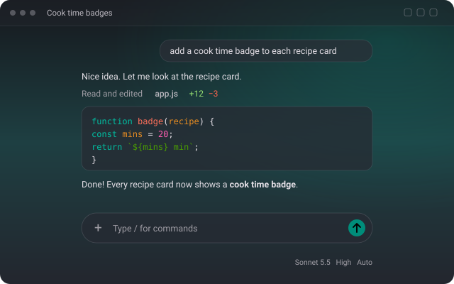</a> <b>Andromeda</b> <code>andromeda</code></td>
</tr>
<tr>
<td align="center" valign="top" width="33%"><a href="gallery/previews/noctis.svg">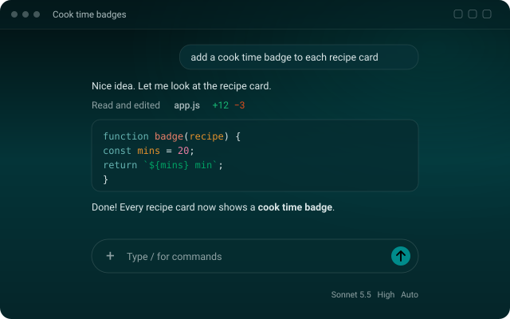</a> <b>Noctis</b> <code>noctis</code></td>
<td align="center" valign="top" width="33%"><a href="gallery/previews/jellyfish.svg">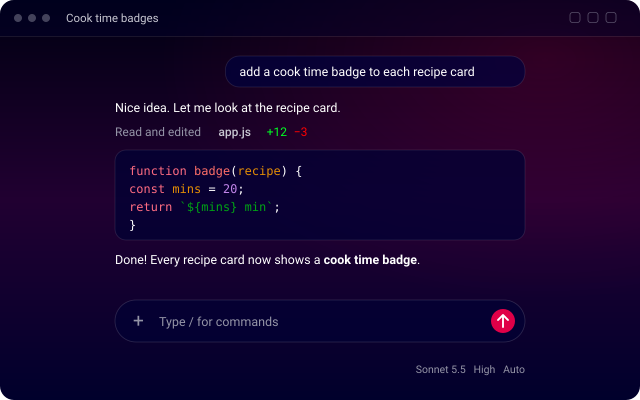</a> <b>JellyFish</b> <code>jellyfish</code></td>
<td align="center" valign="top" width="33%"><a href="gallery/previews/darcula.svg">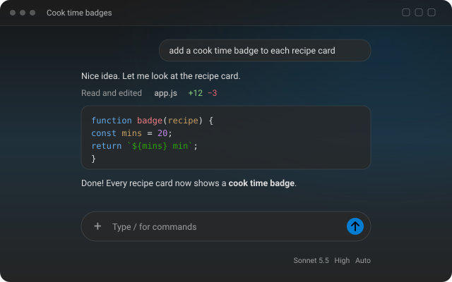</a> <b>Darcula</b> <code>darcula</code></td>
</tr>
<tr>
<td align="center" valign="top" width="33%"><a href="gallery/previews/vue-theme.svg">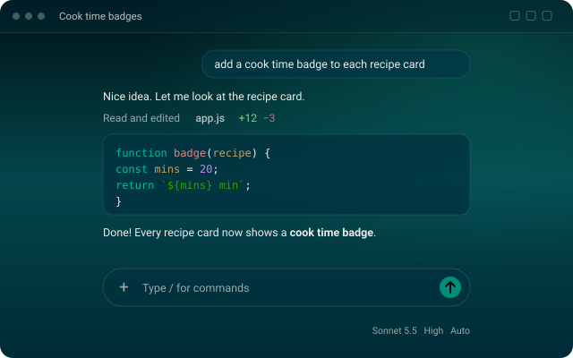</a> <b>Vue Theme</b> <code>vue-theme</code></td>
<td align="center" valign="top" width="33%"><a href="gallery/previews/min-dark.svg">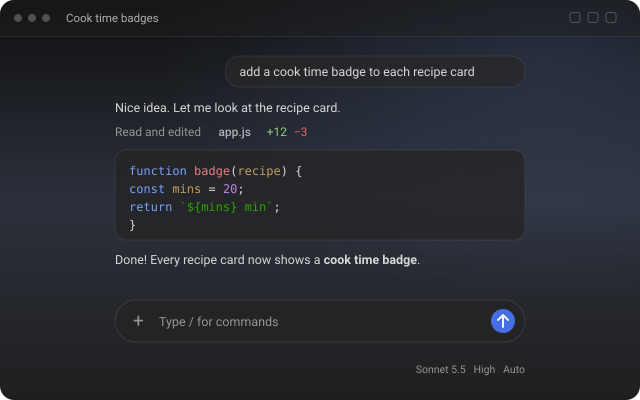</a> <b>Min Dark</b> <code>min-dark</code></td>
<td align="center" valign="top" width="33%"><a href="gallery/previews/absent-contrast-rainglow.svg">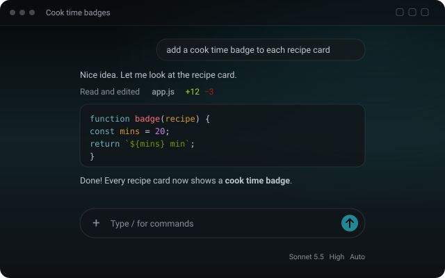</a> <b>Absent Contrast (rainglow)</b> <code>absent-contrast-rainglow</code></td>
</tr>
<tr>
<td align="center" valign="top" width="33%"><a href="gallery/previews/electron.svg">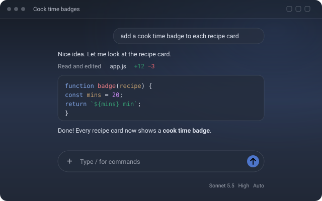</a> <b>Electron</b> <code>electron</code></td>
<td align="center" valign="top" width="33%"><a href="gallery/previews/macos-modern-dark-ventura-xcode-civic.svg">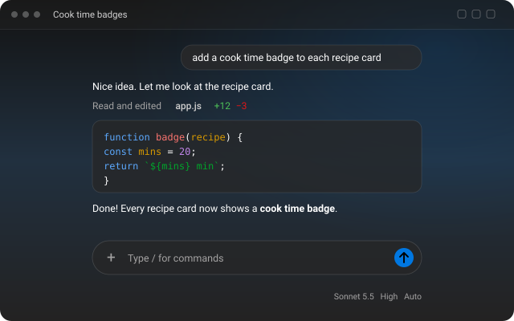</a> <b>MacOS Modern Dark - Ventura Xcode Civic</b> <code>macos-modern-dark-ventura-xcode-civic</code></td>
<td align="center" valign="top" width="33%"><a href="gallery/previews/mayukai-mirage.svg">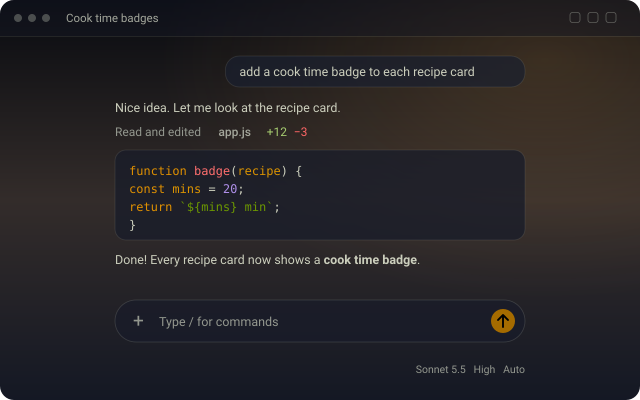</a> <b>Mayukai Mirage</b> <code>mayukai-mirage</code></td>
</tr>
<tr>
<td align="center" valign="top" width="33%"><a href="gallery/previews/narutodark.svg">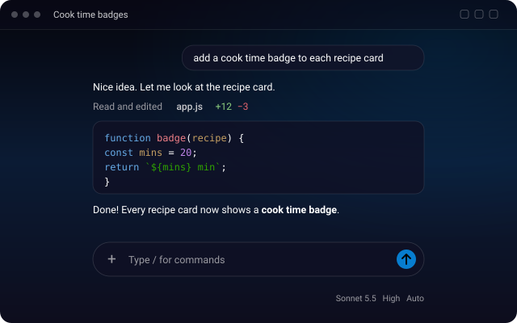</a> <b>NarutoDark</b> <code>narutodark</code></td>
<td align="center" valign="top" width="33%"><a href="gallery/previews/pink-cat-boo.svg">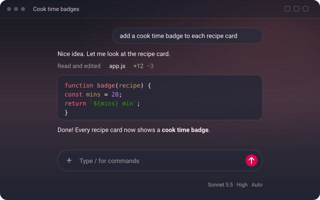</a> <b>Pink Cat Boo</b> <code>pink-cat-boo</code></td>
<td align="center" valign="top" width="33%"><a href="gallery/previews/gitpod-dark.svg">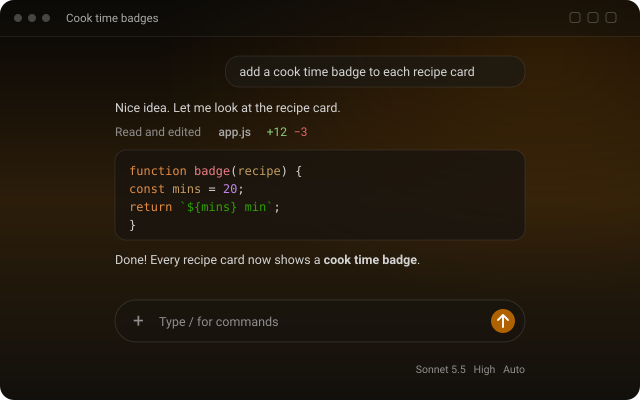</a> <b>Gitpod Dark</b> <code>gitpod-dark</code></td>
</tr>
<tr>
<td align="center" valign="top" width="33%"><a href="gallery/previews/lunar-pink.svg">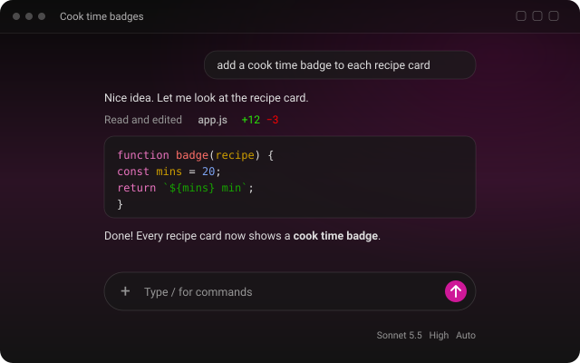</a> <b>Lunar Pink</b> <code>lunar-pink</code></td>
<td align="center" valign="top" width="33%"><a href="gallery/previews/black.svg">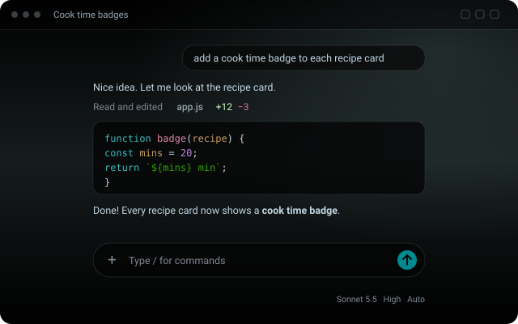</a> <b>Black</b> <code>black</code></td>
<td align="center" valign="top" width="33%"><a href="gallery/previews/hack-the-box.svg">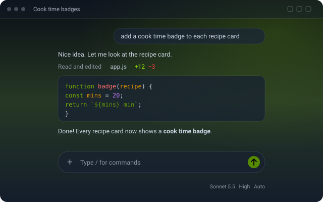</a> <b>Hack The Box</b> <code>hack-the-box</code></td>
</tr>
<tr>
<td align="center" valign="top" width="33%"><a href="gallery/previews/bear-theme.svg">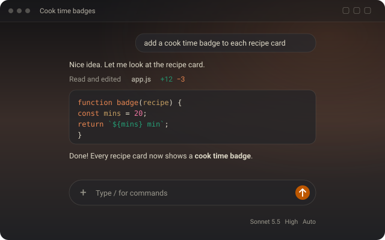</a> <b>Bear Theme</b> <code>bear-theme</code></td>
<td align="center" valign="top" width="33%"><a href="gallery/previews/night-pink.svg">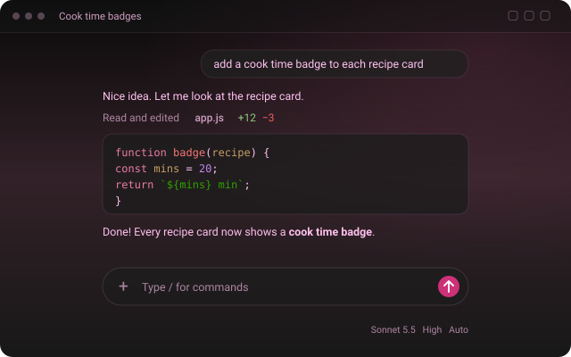</a> <b>Night Pink</b> <code>night-pink</code></td>
<td align="center" valign="top" width="33%"><a href="gallery/previews/vim-dark-medium.svg">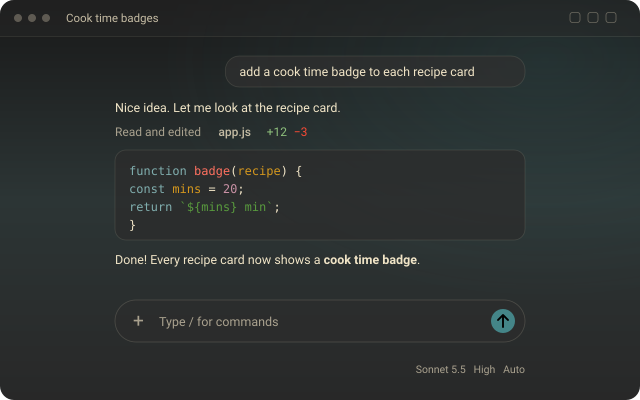</a> <b>Vim Dark Medium</b> <code>vim-dark-medium</code></td>
</tr>
<tr>
<td align="center" valign="top" width="33%"><a href="gallery/previews/halcyon.svg">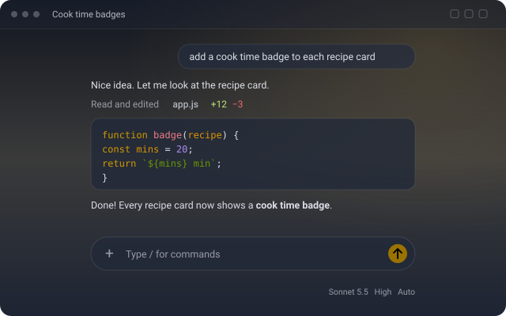</a> <b>Halcyon</b> <code>halcyon</code></td>
<td align="center" valign="top" width="33%"><a href="gallery/previews/firefly-pro.svg">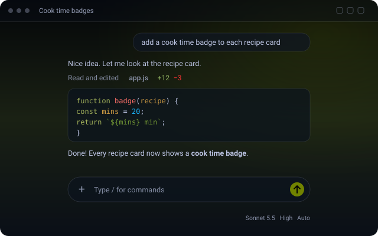</a> <b>FireFly Pro</b> <code>firefly-pro</code></td>
<td align="center" valign="top" width="33%"> <b>codeSTACKr Theme</b> <code>codestackr-theme</code></td>
</tr>
<tr>
<td align="center" valign="top" width="33%"> <b>Firefox Dark</b> <code>firefox-dark</code></td>
<td align="center" valign="top" width="33%"> <b>Xcode Classic (Dark)</b> <code>xcode-classic-dark</code></td>
<td align="center" valign="top" width="33%"> <b>Snazzy Operator</b> <code>snazzy-operator</code></td>
</tr>
<tr>
<td align="center" valign="top" width="33%"> <b>Dark Low Contrast</b> <code>dark-low-contrast</code></td>
<td align="center" valign="top" width="33%"> <b>Pitch Black</b> <code>pitch-black</code></td>
<td align="center" valign="top" width="33%"> <b>Horizon</b> <code>horizon</code></td>
</tr>
<tr>
<td align="center" valign="top" width="33%"> <b>poimandres</b> <code>poimandres</code></td>
<td align="center" valign="top" width="33%"> <b>Monokai Vibrant</b> <code>monokai-vibrant</code></td>
<td align="center" valign="top" width="33%"> <b>Code Blue</b> <code>code-blue</code></td>
</tr>
<tr>
<td align="center" valign="top" width="33%"> <b>August - Arstotzka</b> <code>august-arstotzka</code></td>
<td align="center" valign="top" width="33%"> <b>Pycharm Original Theme</b> <code>pycharm-original-theme</code></td>
<td align="center" valign="top" width="33%"> <b>Radical</b> <code>radical</code></td>
</tr>
<tr>
<td align="center" valign="top" width="33%"> <b>Field Lights</b> <code>field-lights</code></td>
<td align="center" valign="top" width="33%"> <b>Plastic</b> <code>plastic</code></td>
<td align="center" valign="top" width="33%"> <b>Matrix</b> <code>matrix</code></td>
</tr>
<tr>
<td align="center" valign="top" width="33%"> <b>Pop N&#39; Lock Theme by Luxcium ✨</b> <code>pop-n-lock-theme-by-luxcium</code></td>
<td align="center" valign="top" width="33%"> <b>Cobalt Next</b> <code>cobalt-next</code></td>
<td align="center" valign="top" width="33%"> <b>βui - One Dark</b> <code>ui-one-dark</code></td>
</tr>
</table>

## Light (26)

<table>
<tr>
<td align="center" valign="top" width="33%"> <b>Catppuccin Latte</b> <code>latte</code></td>
<td align="center" valign="top" width="33%"> <b>Solarized Light</b> <code>solarized-light</code></td>
<td align="center" valign="top" width="33%"> <b>GitHub Light</b> <code>github-light</code></td>
</tr>
<tr>
<td align="center" valign="top" width="33%"> <b>Gruvbox Light</b> <code>gruvbox-light</code></td>
<td align="center" valign="top" width="33%"> <b>Rosé Pine Dawn</b> <code>rose-pine-dawn</code></td>
<td align="center" valign="top" width="33%"> <b>Ayu Light</b> <code>ayu-light</code></td>
</tr>
<tr>
<td align="center" valign="top" width="33%"> <b>Everforest Light</b> <code>everforest-light</code></td>
<td align="center" valign="top" width="33%"> <b>Nord Snow</b> <code>nord-snow</code></td>
<td align="center" valign="top" width="33%"> <b>Paper Notebook</b> <code>paper</code></td>
</tr>
<tr>
<td align="center" valign="top" width="33%"> <b>Sakura</b> <code>sakura</code></td>
<td align="center" valign="top" width="33%"> <b>Winter is Coming (Light)</b> <code>winter-is-coming-light</code></td>
<td align="center" valign="top" width="33%"> <b>Atom One Light</b> <code>atom-one-light</code></td>
</tr>
<tr>
<td align="center" valign="top" width="33%"> <b>Noctis Lux</b> <code>noctis-lux</code></td>
<td align="center" valign="top" width="33%"> <b>Min Light</b> <code>min-light</code></td>
<td align="center" valign="top" width="33%"> <b>Absent Light (rainglow)</b> <code>absent-light-rainglow</code></td>
</tr>
<tr>
<td align="center" valign="top" width="33%"> <b>Slack Theme Aubergine</b> <code>slack-theme-aubergine</code></td>
<td align="center" valign="top" width="33%"> <b>Slack Theme Aubergine</b> <code>slack-theme-aubergine-felipe-mendes</code></td>
<td align="center" valign="top" width="33%"> <b>MacOS Modern Light - Ventura Xcode</b> <code>macos-modern-light-ventura-xcode</code></td>
</tr>
<tr>
<td align="center" valign="top" width="33%"> <b>Gitpod Light</b> <code>gitpod-light</code></td>
<td align="center" valign="top" width="33%"> <b>Vim Light Medium</b> <code>vim-light-medium</code></td>
<td align="center" valign="top" width="33%"> <b>Firefox Light</b> <code>firefox-light</code></td>
</tr>
<tr>
<td align="center" valign="top" width="33%"> <b>NetBeans Light Theme</b> <code>netbeans-light-theme</code></td>
<td align="center" valign="top" width="33%"> <b>Horizon Bright</b> <code>horizon-bright</code></td>
<td align="center" valign="top" width="33%"> <b>Snazzy Light</b> <code>snazzy-light</code></td>
</tr>
<tr>
<td align="center" valign="top" width="33%"> <b>Quiet Light for VSC</b> <code>quiet-light-for-vsc</code></td>
<td align="center" valign="top" width="33%"> <b>βui - One Light</b> <code>ui-one-light</code></td>
<td></td>
</tr>
</table>
