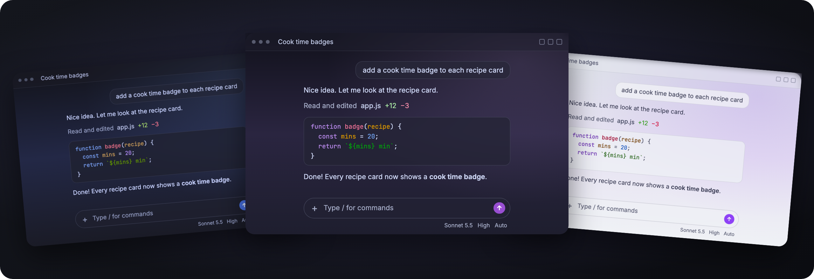
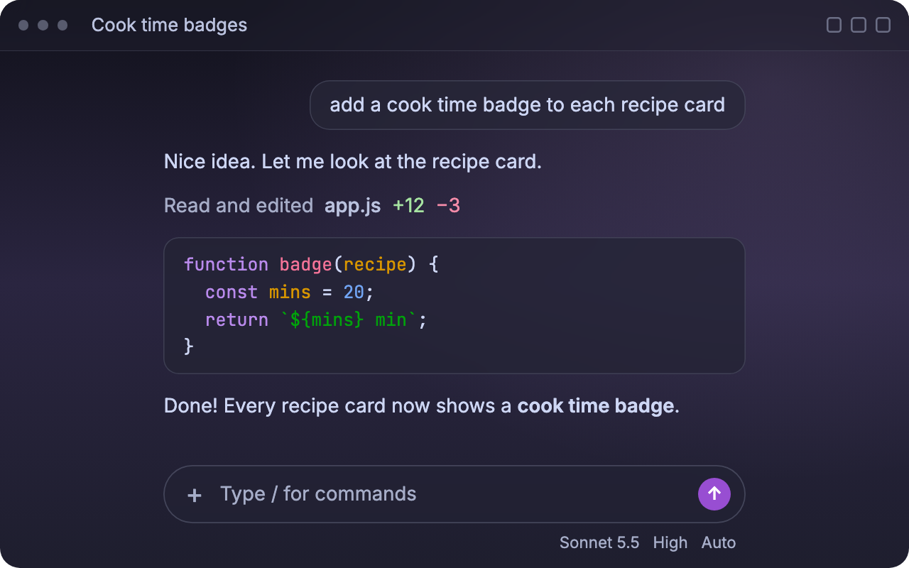
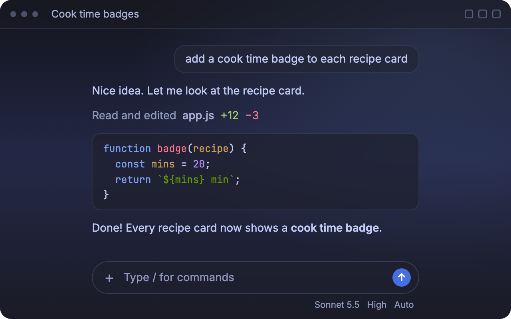
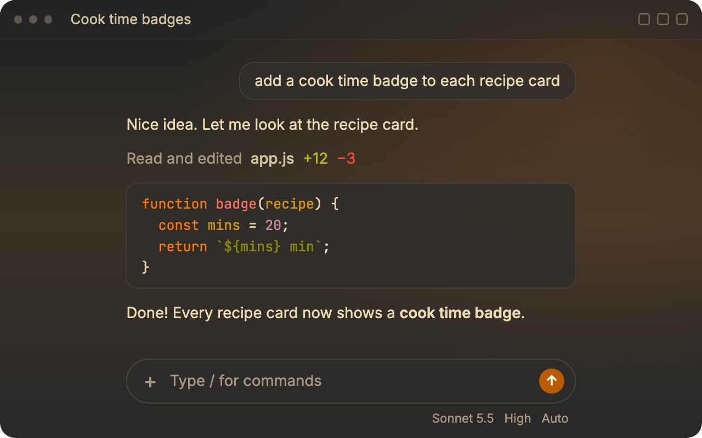
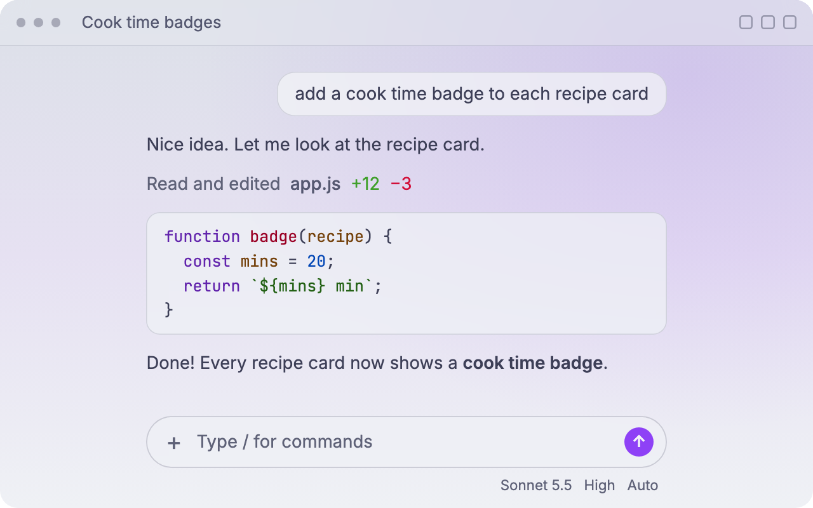
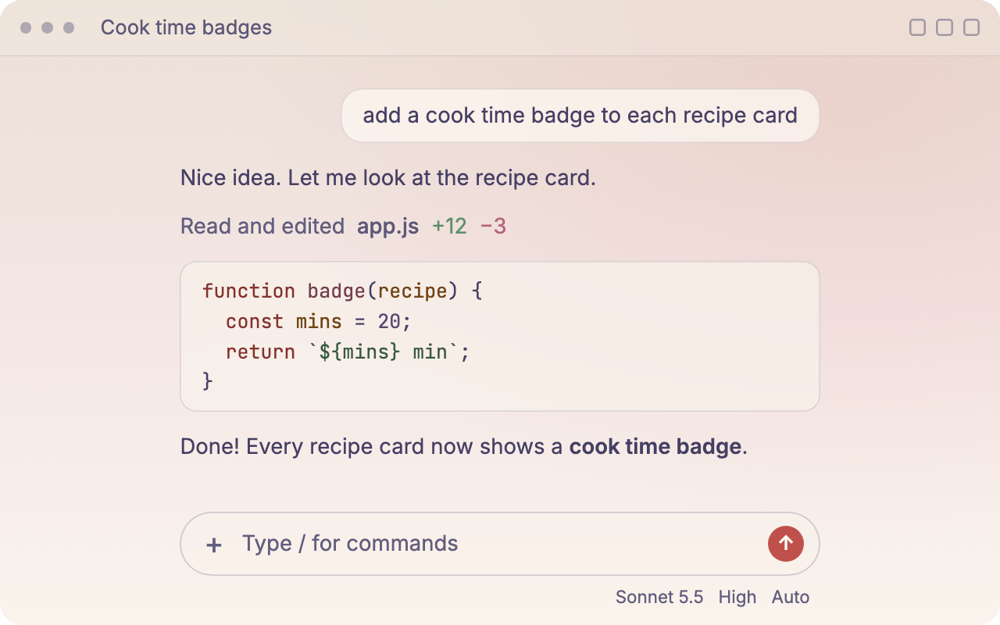
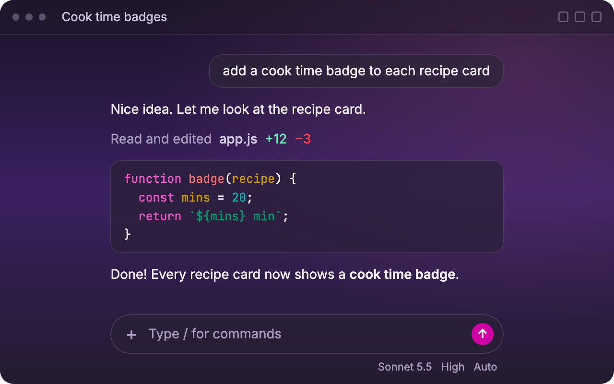

<div align="center">



# looks

**<!-- count:start -->95<!-- count:end --> themes for the Claude desktop and mobile apps.**<br>
Install them all and switch with one command, or install only the one you like.

[Install](#install) &nbsp;·&nbsp; [Gallery](GALLERY.md) &nbsp;·&nbsp; [Interactive gallery](https://briannaworkman.github.io/looks/) &nbsp;·&nbsp; [Credits](CREDITS.md)

</div>

---

## What you get

Each look recolors the whole interface and puts a soft gradient behind the conversation. The app frosts its panels over that gradient, so the prompt box floats on it instead of sitting on a solid strip.

- **Dark and light.** A look is built for one or the other, so a dark look stays dark.
- **Readable first.** Main text is at 7:1 contrast or better against its surfaces in every look, and none trips the check that makes the desktop app refuse a theme.
- **Familiar palettes.** Catppuccin, Nord, Tokyo Night, Gruvbox and more, plus 60 adapted from popular open-source VS Code themes and five made for this gallery.

<!-- featured:start -->
<table>
<tr>
<td align="center" valign="top" width="33%"><a href="gallery/featured/mocha.png"></a><br><b>Catppuccin Mocha</b><br><sub><code>mocha</code></sub></td>
<td align="center" valign="top" width="33%"><a href="gallery/featured/tokyo-night.png"></a><br><b>Tokyo Night</b><br><sub><code>tokyo-night</code></sub></td>
<td align="center" valign="top" width="33%"><a href="gallery/featured/gruvbox.png"></a><br><b>Gruvbox Dark</b><br><sub><code>gruvbox</code></sub></td>
</tr>
<tr>
<td align="center" valign="top" width="33%"><a href="gallery/featured/latte.png"></a><br><b>Catppuccin Latte</b><br><sub><code>latte</code></sub></td>
<td align="center" valign="top" width="33%"><a href="gallery/featured/rose-pine-dawn.png"></a><br><b>Rosé Pine Dawn</b><br><sub><code>rose-pine-dawn</code></sub></td>
<td align="center" valign="top" width="33%"><a href="gallery/featured/synthwave.png"></a><br><b>Synthwave &#39;84</b><br><sub><code>synthwave</code></sub></td>
</tr>
</table>
<!-- featured:end -->

<p align="center"><sub>Previews are renderings built from each look's colors, not captures from the app. <a href="GALLERY.md">See all of them</a>.</sub></p>

## Install

Every look is its own small mod, named `look-` plus its name from the [gallery](GALLERY.md), and one more mod, `looks`, bundles all of them with a switcher. You install from the Claude desktop app or from a terminal session. Either way, add this repository as a marketplace first, then add a look from it.

### In the desktop app

`/plugin install ...` does not run as a command in the desktop app. Typing it opens the app's own plugin directory and searches that, and this repository is not in it, so a search for `look-mocha` finds an unrelated plugin. Add the marketplace first:

1. Open the **Plugins** list (click **+** next to the prompt box, then **Plugins**).
2. Click **+ Add** and choose the option to add a marketplace.
3. Enter `briannaworkman/looks`.
4. Search for a look, such as `look-nord`, and add it. Add `looks` instead for the bundle.

### In a terminal session

```
/plugin install look-nord --marketplace briannaworkman/looks
```

Answer `y` to add the marketplace, then choose a scope. The **user** scope loads it in every session you start afterward. Or from a shell:

```bash
claude plugin install look-nord --marketplace briannaworkman/looks
```

### Which to install

**Just one look.** A session shows one theme at a time, so install one. If you install two single looks, whichever loads last wins.

**All of them, with a switcher.** Install the `looks` bundle (`/plugin install looks --marketplace briannaworkman/looks`), then:

```
/look             list every look, with the current one marked
/look nord        switch to Nord
/look next        step to the next look
```

The bundle starts on `mocha` and remembers the last look you chose across sessions. Don't install it together with single looks: they would set their themes against each other.

### When it takes effect

A look applies when a session starts. After installing, new sessions are themed. A session that was already open is not, so start a new one or restart it. Themes draw in the desktop and mobile apps, not in a terminal or an editor.

## Browse the looks

- **[GALLERY.md](GALLERY.md)** shows a preview of every look, dark and light.
- **[The gallery site](https://briannaworkman.github.io/looks/)** shows every look as a polaroid, with search and filters, the exact colors of each look, and a copy button for its install line.
- Cloning the repository also gives you `docs/index.html`, the same interactive page, to open in a browser.

<!-- names:start -->
<details>
<summary>All 95 look names</summary>

**Dark** (69): `mocha` `nord` `dracula` `tokyo-night` `gruvbox` `rose-pine` `everforest` `solarized-dark` `frappe` `macchiato` `one-dark` `kanagawa` `ayu-mirage` `github-dark` `night-owl` `synthwave` `monokai` `amber-crt` `tokyo-night-storm` `nightfox` `oxocarbon` `material-ocean` `zenburn` `deep-sea` `mint-chocolate` `winter-is-coming-dark-blue` `one-monokai` `palenight-theme` `cobalt2` `andromeda` `noctis` `jellyfish` `darcula` `vue-theme` `min-dark` `absent-contrast-rainglow` `electron` `macos-modern-dark-ventura-xcode-civic` `mayukai-mirage` `narutodark` `pink-cat-boo` `gitpod-dark` `lunar-pink` `black` `hack-the-box` `bear-theme` `night-pink` `vim-dark-medium` `halcyon` `firefly-pro` `codestackr-theme` `firefox-dark` `xcode-classic-dark` `snazzy-operator` `dark-low-contrast` `pitch-black` `horizon` `poimandres` `monokai-vibrant` `code-blue` `august-arstotzka` `pycharm-original-theme` `radical` `field-lights` `plastic` `matrix` `pop-n-lock-theme-by-luxcium` `cobalt-next` `ui-one-dark`

**Light** (26): `latte` `solarized-light` `github-light` `gruvbox-light` `rose-pine-dawn` `ayu-light` `everforest-light` `nord-snow` `paper` `sakura` `winter-is-coming-light` `atom-one-light` `noctis-lux` `min-light` `absent-light-rainglow` `slack-theme-aubergine` `slack-theme-aubergine-felipe-mendes` `macos-modern-light-ventura-xcode` `gitpod-light` `vim-light-medium` `firefox-light` `netbeans-light-theme` `horizon-bright` `snazzy-light` `quiet-light-for-vsc` `ui-one-light`

</details>
<!-- names:end -->

## Add your own

Every look is one entry in [`src/themes.js`](src/themes.js): an id, a name, a mode, three gradient colors (`sky`, top to bottom) and the colors `makeColors` turns into a full theme. Copy an entry, change the colors, then build:

```bash
node scripts/build.mjs
```

The build checks each look and refuses one the desktop app would not paint. It writes each look's mod and the bundle into `plugins/`, a preview image for each into `gallery/previews/`, the gallery pages, the marketplace file, `CREDITS.md` and the lists in this README. Commit what it writes, and edit `src/` rather than the generated files.

The banner and the featured strip are PNGs, drawn at 2x by headless Chrome so they look the same in every browser. If you change which looks they show (`src/featured.js`) or a look's colors, redraw them with `node scripts/export-png.mjs` after building. It needs Google Chrome installed.

Each plugin's icon is drawn the same way, once, into `src/icons/` with `node scripts/export-icons.mjs`, and the build copies it into the plugin as `.claude-plugin/icon.png`. Redraw them after changing a look's colors.

Two things keep a look readable:

- Keep each mode's surfaces close together, a few percent of lightness apart. The darker the page, the less room there is between it and the menus.
- Keep the gradient dark (or light) and low in contrast, since text sits on top of it under frosted panels.

## Publish the gallery site

`docs/index.html` is one static page with no dependencies beyond three web fonts, built from `src/site/`. It is served on GitHub Pages straight from the `docs/` folder of the `main` branch, at https://briannaworkman.github.io/looks/, and redeploys when a change to `docs/` is pushed. Any static host works the same way: point it at `docs/`.

## Credits

Every look's origin, and the credit its colors are owed, is in [CREDITS.md](CREDITS.md): the published palettes, the themes adapted from VS Code extensions (with each one's author, source repository and license), the original looks, and the color helper.

## License

MIT, see [LICENSE](LICENSE). The color helper in `src/make-colors.js` keeps its own origin, noted in [CREDITS.md](CREDITS.md).
